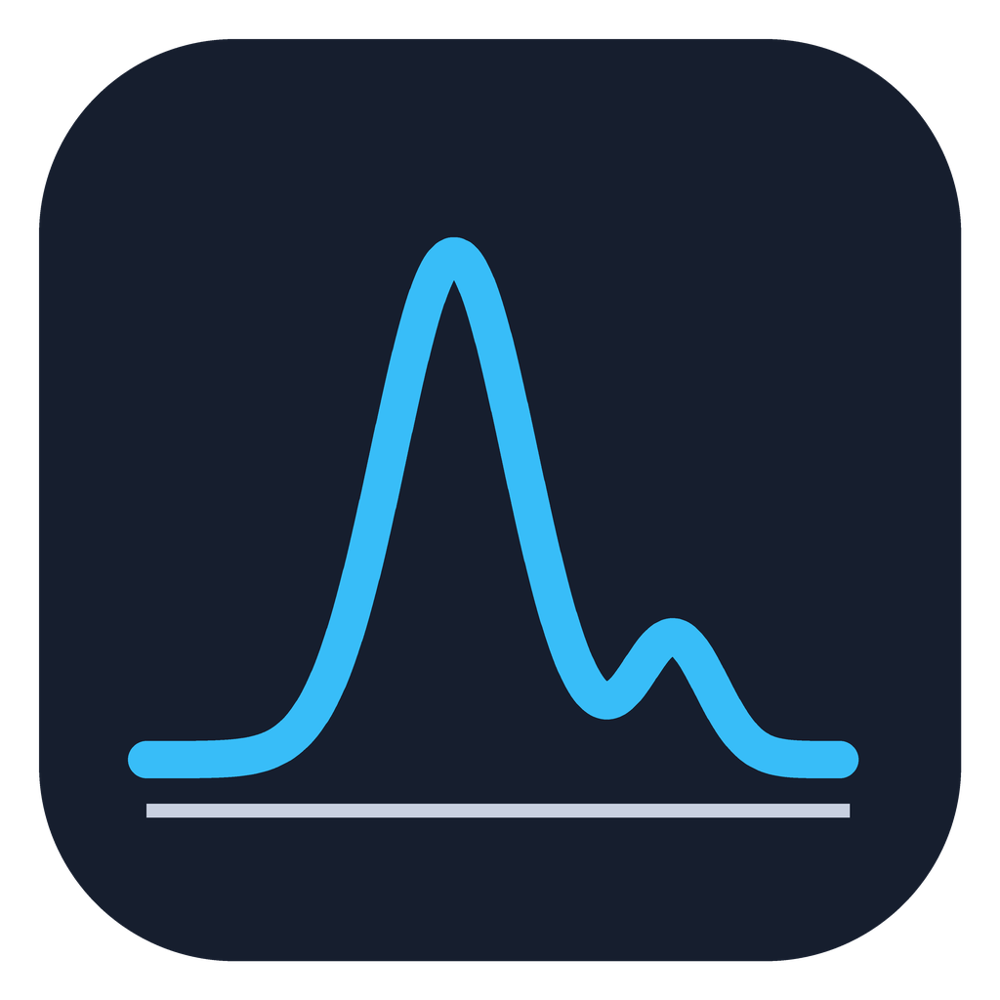

<p align="center"></p>

# Omnes by Pham

Point it at a folder of spectrometer exports, or pick the files yourself. It recognises each file,
aligns everything on wavelength, and writes **one Excel workbook**, optionally **one Origin project**
and **one PowerPoint deck**. No Origin installation is needed for the `.opju` or the embedded graphs.

## Download (no Python needed)

Go to **[Releases](../../releases/latest)** and download:

* Windows: `Omnes-windows.zip`. Unzip, then run `Omnes.exe` inside.
* Mac: `Omnes-mac-apple-silicon.zip` (M1 and newer) or `Omnes-mac-intel.zip`.
  Unzip and drag the app into Applications. The app isn't signed by Apple, so the first time,
  right-click it → **Open** → **Open**.

## Run from source

| | Windows (`Windows/`) | Mac (`Mac/`) |
|---|---|---|
| Set up once | `setup-windows.bat` | first run of `Run Omnes.command` |
| Start | `run-omnes.bat` | `Run Omnes.command` |
| Desktop shortcut | `make-shortcut.bat` | |
| Build the app | `build-windows-exe.bat` | `Build Mac app.command` |

Each folder is complete on its own (Python 3.10+). The [Windows](Windows/README.md) and
[Mac](Mac/README.md) READMEs have details. Headless use:
`python -m datacleaner "<folder or files>" --opju --pptx` (`--help` lists every option).

## Using it

**Choose Folder…** (everything in it) or **Choose Files…** (just the ones you pick), then **Run**.
The log shows what each file was recognised as and anything that was skipped. Outputs go next to
the inputs.

The options live behind **⚙ Settings** and are remembered between launches; a one-line summary
under the file choice shows what's on.

### How the sheets are arranged

One sheet per **file** or per **instrument group**, never one per sample:

* a file that holds several spectra (a Cary `.csv`, an `.FBSW` batch) gets its own sheet, named
  after the file;
* files that hold one spectrum each are pooled by instrument: every Ocean Optics `.txt` in one
  **Ocean Optics** sheet, every Duetta `.ezspec_data` in one **Duetta** sheet, and so on;
* each EEM gets its own sheet (plus its raw-signal / settings sheets when it has them).

The Origin project mirrors this: one sheet per group in the **Spectra** book, each with its own
overlay graph.

| Setting | What it does |
|---|---|
| File format | Auto-detect (default), or force one format for every file |
| Include subfolders | also scan folders inside the chosen one |
| Merge files | one workbook for everything (default); untick for one workbook per input file, written to `cleaned/` |
| Also save Origin project | writes a `.opju` next to the workbook |
| + EEM contour graphs | **experimental**: adds a contour graph per EEM sample (they open in OriginPro but don't show data yet) |
| Export graphs to PowerPoint | writes a `.pptx` with one slide per graph (see below; the graphs can't be opened in Origin from PowerPoint yet) |
| Interpolate across grids | fills gaps between different wavelength grids, inside each sample's own range only |
| Average to integer wavelengths | averages every point that rounds to the same whole nm (half rounds up) |

## Supported files (auto-detected)

**Spectra**

| Instrument | File |
|---|---|
| Varian / Agilent Cary UV-Vis | `.csv` (each sample may have its own wavelength grid) |
| Agilent diode array | `.dx` (JCAMP-DX) |
| Ocean Optics | `.txt` (SpectraSuite / OceanView) |
| Varian Cary Eclipse | `.FBSW` (binary) or its `.csv` export |
| HORIBA Duetta / EzSpec | `.ezspec_data`, `.dat`, `TableHeaderData.txt` |
| ISS K2 | `.ifx` |
| FT-300 | `.dat` |
| anything else | any file with a two-column numeric block |

**Excitation-emission matrices (EEMs)** become one sheet per sample, with columns named by
excitation wavelength only (`Wavelength (nm)`, `250`, `260`, …):

| Instrument | File |
|---|---|
| Varian Cary Eclipse | `.FBSW` batch, or its `.csv` export (`<sample>_EX_<nm>` columns) |
| HORIBA Duetta | `.dat` matrix export, or `.ezspec_data` |
| HORIBA EzSpec session folder | adds the decoded raw signals (below) |

When the same data exists twice (e.g. `S503.FBSW` and `S503.csv`, or `15_EEM.dat` and
`15_EEM.ezspec_data`), the most complete copy is used and the duplicate is skipped.

### EzSpec session folders

A Duetta acquisition folder (`<name>.ezspec_data`, `Signals.ezspec_data`, `*.ezspec_raw`) also
yields: raw CCD counts and the dark frame, reference and transmission photodiode currents,
the instrument correction curves, all 2048 CCD pixels per frame from the binary `.ezspec_raw`,
per-frame timing and filter settings, and the acquisition settings. The corrected EEM is
recomputed from the raw signals on every run as a check:

```
EEM(em, ex) = (CCD − CCD_dark) / (Ref − Ref_dark) × MCorrect(em) / XCorrect(ex)
```

## Origin projects without Origin

`datacleaner/opju_build.py` writes `.opju` files directly. The layout was reverse-engineered
from projects saved by OriginPro 2023 (format CPYUA 4.3683) and builds on the container work in
Principio. A project contains:

* **Spectra** book: `Wavelength (nm)` + one column per sample, and an overlay line graph
* **EEM** book: one sheet per sample

Round trips are verified in `tests/`. Files open in OriginPro 2023 and 2025.

## PowerPoint export

One slide per graph, 16:9, laid out the way OriginPro pastes a graph: the graph page at its own
aspect ratio, centred, aspect locked, no extra title box (each graph is named in the Selection Pane).

> **Warning:** the embedded graphs can't be opened in Origin from PowerPoint yet (double-clicking
> them fails). They display fine, and Principio's PowerPoint add-in opens them.

* **Spectra**: one slide per sheet. The overlay graph is embedded as a real **Origin graph object**, the same OLE object
  OriginPro creates with "Send Graphs to PowerPoint" (see the warning above about opening it in
  Origin); Principio's PowerPoint add-in can edit it. Until Origin refreshes it, the slide shows a
  preview drawn in Origin's default style (Arial, Origin's colour list, box frame, outward ticks).
* **EEMs**: a filled contour picture per sample (excitation vs emission). The colour scale is taken
  from the fluorescence only, leaving out first- and second-order Rayleigh scatter so peaks stay
  visible. With the experimental contour option these are embedded Origin objects as well.

## Repository layout

```
Windows/ , Mac/                 the same app, plus each platform's scripts
  run_datacleaner.py            entry point (double-click / PyInstaller)
  datacleaner/
    __main__.py                 command line (python -m datacleaner)
    gui.py                      window
    pipeline.py                 scanning, alignment, averaging, workbook writing
    detect.py                   format registry / auto-detection
    parsers.py                  Cary, JCAMP, Ocean Optics, Duetta, K2, FBSW, EEM .dat
    ezspec.py                   HORIBA EzSpec XML, session folders, binary .ezspec_raw
    origin.py                   Origin project output
    opju_build.py               .opju writer (no Origin needed)
    pptx_export.py              PowerPoint deck with embedded Origin graphs
    core.py                     shared helpers and the EEM model
  tests/test_basic.py           smoke tests on synthetic data
.github/workflows/release.yml   builds the Windows and Mac apps for each Release
```

## Making a release

Releases → **Draft a new release** → new tag (e.g. `v12.1`) → **Publish**. GitHub Actions builds
`Omnes-windows.zip`, `Omnes-mac-apple-silicon.zip` and `Omnes-mac-intel.zip` and
attaches them to the release (Actions tab shows progress, about 10 minutes).
